<picture><source media="(prefers-color-scheme: dark)" srcset="./assets/sheet/masthead-dark.svg" /></picture>

  <a href="https://narayanangourav.github.io/cv-portfolio"><picture><source media="(prefers-color-scheme: dark)" srcset="./assets/buttons/portfolio-dark.svg" /></picture></a>&nbsp;
  <a href="https://www.linkedin.com/in/narayana-n-gourav"><picture><source media="(prefers-color-scheme: dark)" srcset="./assets/buttons/linkedin-dark.svg" /></picture></a>&nbsp;
  <a href="mailto:narayanagourav@gmail.com"><picture><source media="(prefers-color-scheme: dark)" srcset="./assets/buttons/email-dark.svg" /></picture></a>

 

<picture><source media="(prefers-color-scheme: dark)" srcset="./assets/sheet/about-dark.svg" /></picture>

<picture><source media="(prefers-color-scheme: dark)" srcset="./assets/sheet/mindset-dark.svg" /></picture>

<picture><source media="(prefers-color-scheme: dark)" srcset="./assets/sheet/focus-dark.svg" /></picture>

<picture><source media="(prefers-color-scheme: dark)" srcset="./assets/sheet/stack-dark.svg" /></picture>

<picture><source media="(prefers-color-scheme: dark)" srcset="./assets/sheet/collaborate-dark.svg" /></picture>

<picture><source media="(prefers-color-scheme: dark)" srcset="./assets/sheet/ask-dark.svg" /></picture>

<picture><source media="(prefers-color-scheme: dark)" srcset="./assets/sheet/closing-dark.svg" /></picture>
